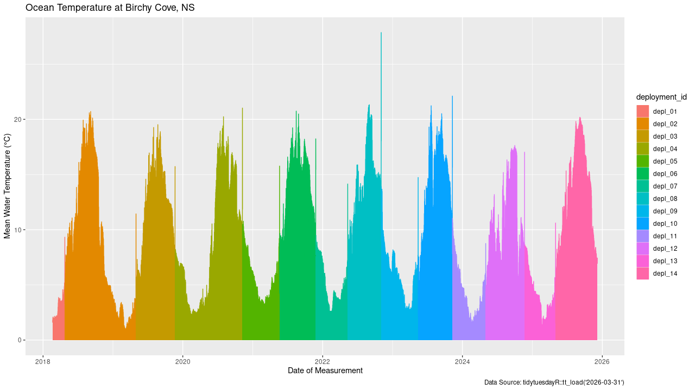
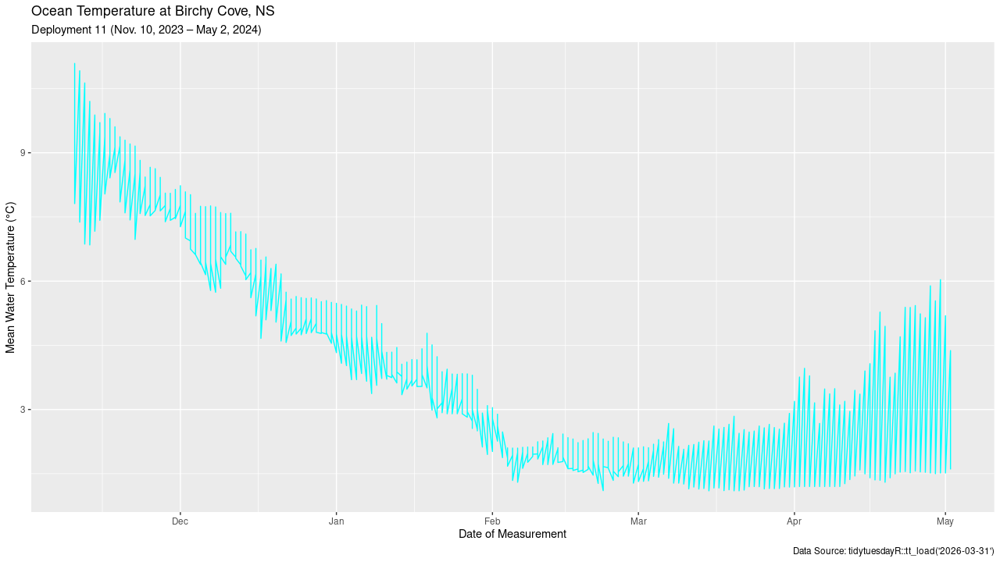
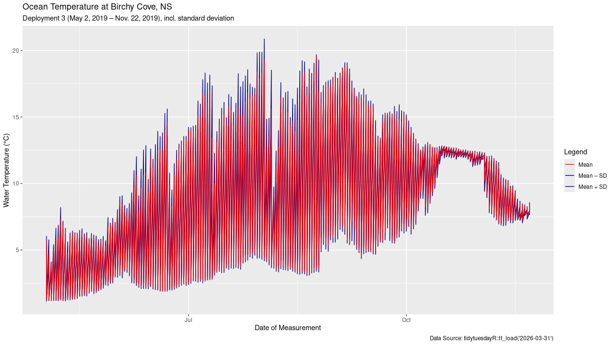

# Assignment 6: Visualizing Ocean Temperature Data with ggplot2

## Jared Tyler — Nov. 22, 2026

### Overview
Starting with the plot we generated in class, I made the plot more presentable by adding appropriate labels and titles.  I also created copies to zoom in on specific deployments to view the data in more detail and see how its standard deviation changes over time.

### Plot 1: Improve the class plot

Copied the plot we generated in class.  Added a title, axis labels, and a caption referencing the source of the data.

### Plot 2: A single deployment

Selected Deployment 11, since it has an nice spread of seasons.  As one would expect, the mean ocean temperature drops during Winter, then starts warming back up again during the Spring.  Interesting to note that during the dead of Winter in February, there's less variation in temperature (it's consistently cold), but then the temperature becomes much more chaotic in the second half of April (since temperatures are much less consistent during Spring).

### Plot 3: A different deployment, with standard deviation

Selected Deployment 3, since it had an interesting slice during October where there is less variation in mean temperature, and a distinctly tighter SD throughout that slice.

### Sources
dataset: https://github.com/rfordatascience/tidytuesday/tree/main/data/2026/2026-03-31  
ggplot2 reference docs: https://ggplot2.tidyverse.org  
ggplot2 cheatsheet: https://github.com/rstudio/cheatsheets/blob/master/data-visualization.pdf
